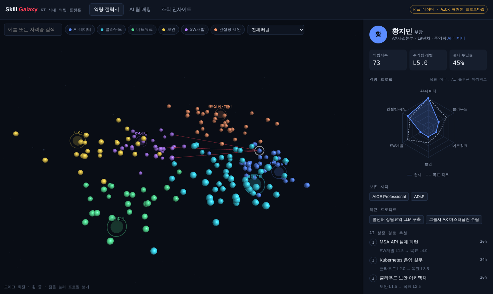

# AIDx 해커톤 Pro-Code 리소스 정리

> 기준: 기술 70점은 문서·코드·실행/테스트 결과·GitHub 이력·AI 활용 기록을 AI 3종(Claude·Codex·Copilot)이 평가.
> 핵심은 **REQ → AC → Issue → 코드 → TC → 실제 결과**가 ID로 연결돼 있는 것. 도구 수·Issue 수는 가산점 아님.
>
> **순위 기준**: 분류 안에서 ① 평가 근거에 직접 남는 정도 ② 도입 난이도 ③ 다른 항목과의 중복 순으로 매김. 위에서부터 도입, 시간이 부족하면 아래부터 제외. "택1"은 둘 중 하나만 사용
>
> **최신 모델 기준**: Claude 5세대 모델(2026-06 출시) 이후에도 관리되는 것만 남김. 업데이트가 그 전에 멈춘 스킬은 제외하고, 기본 모델이 구버전으로 박혀 있는 도구는 메모에 최신 모델로 바꾸는 방법 표기. 각 항목의 "최근 업데이트"는 2026-10-13 확인 기준
>
> **예시**: 표 오른쪽 칸에 바로 표시 (이미지를 누르면 원본 크기). 각 프로젝트 README의 공식 이미지를 원본 주소로 불러온 것이라 원본이 바뀌면 안 보일 수 있음. 공식 이미지가 없으면 "—"로 표시하고 메모에 결과 형태 기재

---

## 0. 주최 측 고정 조건

| 항목 | 내용 | 확인할 것 |
|---|---|---|
| 프런트엔드 | React 계열 필수 (React, Next.js 등) | — |
| 백엔드 / DB | 자유 선택 (SQL·NoSQL 모두 가능) | 팀 역량 기준으로 단일 스택 권장 |
| 디자인 | 자유 선택. KDS (KT UX Design System v2.0) 사용 가능 (필수 아님) | 쓸지 여부를 초반에 팀에서 확정. 쓰면 개발자 안내 p.18–23, 포털 Resources → Developer 참고 |
| KDS 접근 (사용 시) | 회사 GitHub 로그인 + 저장소 읽기·패키지 설치 권한 필요 | KDS를 쓰기로 하면 팀원 3명 모두 사전 권한 확인, 토큰 공유 금지 |
| 보안 기준 | 주최 측 docs/security-policy.md (팀이 수정 불가) | 공개되면 SEC 항목 목록부터 뽑기 |
| 제출 문서 | README.md + docs/ 7개 (project-brief, prd, arch, experience, development, security-compliance, e2e-test) | 제출 소스 SHA에 전부 포함됐는지 |

**링크**
- KDS 포털 (선택): https://uxdesign.kt.com/054231ea3/p/786e86-designer
- 온보딩 가이드: https://aidx-onboarding.koreacentral.cloudapp.azure.com/

## 1. 기술 스택 (React 필수 조건 반영)

| 순위 | 이름 · 용도 · 메모 | 예시 |
|:-:|---|---|
| 1 | **[Next.js](https://nextjs.org) (App Router) + [TypeScript](https://www.typescriptlang.org)**<br>웹 화면과 서버 기능을 한 프로젝트 안에서 같이 만드는 React 기반 개발 틀. TypeScript는 오타·형식 실수를 실행 전에 잡아주는 JavaScript (연결: arch.md)<br><sub>필수 조건 충족. 백엔드를 Route Handler로 처리하면 배포·설명이 쉬움</sub> | — |
| 2 | **KDS 해커톤 키트 (주최 측 배포 zip, 선택)**<br>KT 공식 디자인 재료 모음. 버튼·카드·입력창 같은 부품과 색·글꼴을 가져다 쓰면 화면이 KT 스타일로 통일됨<br><sub>필수 아님. 안 쓰면 6번 분류의 shadcn/ui 등 디자인 기준 하나를 정해 통일. 공개 링크 없음 (참가자에게만 배포). React 컴포넌트가 아니라 CSS 클래스 방식. 사내 자료라 공개 레포·캡처 업로드 금지, KT Flow 폰트는 공개 업로드 금지. 포털: https://uxdesign.kt.com/054231ea3/p/786e86-designer</sub> | — |
| 3 | **[Zod](https://zod.dev)**<br>사용자가 입력한 값이 올바른지 검사하는 도구. 이메일 칸에 엉뚱한 글자가 들어오면 차단 (연결: security-compliance.md "잘못된 요청 거부")<br><sub>프런트·API 같은 스키마 공유</sub> | — |
| 4 | **[Mermaid](https://mermaid.js.org)**<br>글로 적으면 흐름도·구조도 그림으로 바꿔주는 도구. GitHub 문서에 코드만 써도 그림으로 표시 (연결: arch.md, experience.md)<br><sub>GitHub에서 코드 블록만으로 그림 렌더링</sub> | <a href="https://raw.githubusercontent.com/mermaid-js/mermaid/develop/img/header.png"></a> |
| 5 | **[Prisma](https://www.prisma.io) 또는 [Drizzle](https://orm.drizzle.team) (택1)**<br>데이터베이스를 코드로 다루는 도구. 표 구조를 정의한 파일 자체가 데이터 저장 방식 설명서 역할 (연결: arch.md)<br><sub>DB를 쓰는 주제일 때</sub> | — |
| 6 | **[MSW](https://mswjs.io) (Mock Service Worker)**<br>아직 없는 외부 시스템을 흉내 내는 가짜 서버. 실제 연결 없이 화면 개발과 시험 가능 (연결: arch.md "mock 구분")<br><sub>외부 연동이 있는 주제일 때. 개발자도구 네트워크 탭에 mock 응답이 보임</sub> | <a href="https://github.com/mswjs/msw/blob/main/media/msw-quick-look-network.png?raw=true"></a> |


## 2. 테스트·검증 (e2e-test.md / 기술점수 핵심)

| 순위 | 이름 · 용도 · 메모 | 예시 |
|:-:|---|---|
| 1 | **[Playwright](https://playwright.dev)**<br>사람 대신 브라우저를 자동으로 클릭·입력하며 실제 동작을 확인하는 시험 도구. 결과를 화면 캡처와 보고서로 기록 (연결: e2e-test.md)<br><sub>`npx playwright show-report`의 HTML 리포트·트레이스가 결과 근거</sub> | — |
| 2 | **[Vitest](https://vitest.dev) + [React Testing Library](https://testing-library.com/docs/react-testing-library/intro/)**<br>함수·부품 단위로 동작을 빠르게 확인하는 시험 도구. 시험 이름에 요구사항 번호를 붙여 요구사항과 연결 (연결: e2e-test.md)<br><sub>테스트명에 `AC-01` 같은 ID 포함</sub> | — |
| 3 | **[GitHub Actions](https://docs.github.com/actions)**<br>코드를 올릴 때마다 시험을 자동 실행하는 GitHub 기능. 코드 버전별 통과·실패 기록 보관 (연결: e2e-test.md, README)<br><sub>PR 체크 결과를 e2e-test.md에 링크</sub> | — |
| 4 | **[playwright-skill](https://github.com/lackeyjb/playwright-skill) 또는 [dev-browser](https://github.com/SawyerHood/dev-browser) (택1)**<br>Claude가 직접 브라우저를 열고 눌러보며 시험을 작성·실행하게 하는 스킬. 시험 코드 수작업 감소<br><sub>Claude가 클릭·입력하며 시험하고 결과 보고</sub><br><sub>최근 업데이트 2026-08-14</sub> | — |
| 5 | **[@axe-core/playwright](https://github.com/dequelabs/axe-core-npm/tree/develop/packages/playwright)**<br>색 대비·글자 크기 등 누구나 쓸 수 있는 화면인지 자동 검사하는 도구. 문제 개수가 숫자로 나와 근거 자료로 활용<br><sub>6번 분류 web-accessibility와 짝. 위반 항목 목록 출력</sub> | — |
| 6 | **[web-quality-skills](https://github.com/addyosmani/web-quality-skills)**<br>접근성·로딩 속도(Core Web Vitals)·SEO·모범 사례를 한 번에 점검하는 스킬 모음. 구글 크롬팀 출신 Addy Osmani 제작<br><sub>`npx skills add addyosmani/web-quality-skills` · web-quality-audit으로 전체 점검 후 점수·지적 사항을 e2e-test.md 결과 근거로 첨부</sub><br><sub>최근 업데이트 2026-08-24</sub> | — |
| 7 | **[guard-skills](https://github.com/amElnagdy/guard-skills)**<br>AI 결과물의 흔한 실수(빠진 테스트, 근거 없는 "완료" 표시 등)를 찾아주는 점검 스킬<br><sub>"완료인데 근거 없음" 잡는 용도</sub><br><sub>최근 업데이트 2026-07-04</sub> | — |
| 8 | **[tdd-guard](https://github.com/nizos/tdd-guard)**<br>테스트를 먼저 쓰지 않으면 코드 수정을 막는 장치. 시험 없이 기능만 만드는 실수 방지<br><sub>속도가 느려지면 해제</sub><br><sub>최근 업데이트 2026-10-12</sub> | <a href="https://raw.githubusercontent.com/nizos/tdd-guard/main/docs/assets/tdd-guard-demo.gif"></a> |


## 3. 보안 (security-compliance.md)

| 순위 | 이름 · 용도 · 메모 | 예시 |
|:-:|---|---|
| 1 | **[claude-code-security-review](https://github.com/anthropics/claude-code-security-review) (Anthropic 공식)**<br>코드 변경을 올릴 때마다 AI가 보안 문제를 찾아 댓글로 알려주는 자동 검사. Anthropic 공식<br><sub>**기본 모델이 구버전(Opus 4.1)** → Action 입력값 `claude-model`을 최신 모델(예: `claude-opus-5-5`)로 지정해서 사용. PR에 취약점별 코멘트를 남김</sub><br><sub>최근 업데이트 2026-02-11</sub> | — |
| 2 | **[gitleaks](https://github.com/gitleaks/gitleaks)**<br>비밀번호·API 키 같은 비밀값이 코드에 섞여 올라가는 것을 찾아 차단하는 도구<br><sub>pre-commit + CI</sub><br><sub>최근 업데이트 2026-07-22</sub> | <a href="https://github.com/gitleaks/gitleaks/assets/15034943/76c30a85-887b-47ca-9956-17a8e55c6c41"></a> |
| 3 | **[npm audit](https://docs.npmjs.com/cli/commands/npm-audit) / [Dependabot](https://docs.github.com/code-security/dependabot)**<br>가져다 쓴 외부 라이브러리의 알려진 보안 구멍을 검사하고 업데이트를 알려주는 기능<br><sub>결과 화면을 근거로 첨부</sub> | — |
| 4 | **[security-audit-skill](https://github.com/cloudflare/security-audit-skill) (Cloudflare)**<br>AI가 보안 감사관처럼 단계별로 코드를 점검하고 확인된 문제만 보고하는 스킬<br><sub>security-compliance.md 근거 생성</sub><br><sub>최근 업데이트 2026-09-14</sub> | — |
| 5 | **[eslint-plugin-security](https://github.com/eslint-community/eslint-plugin-security) 또는 [Semgrep](https://semgrep.dev) (택1)**<br>코드를 실행하지 않고 읽기만 해서 위험한 코딩 패턴을 찾는 검사기. 문제 파일과 줄 번호 표시<br><sub>security-policy 항목에 맞춰 룰 선택</sub><br><sub>최근 업데이트 2026-10-01</sub> | — |
| 6 | **[defending-code-reference-harness](https://github.com/anthropics/defending-code-reference-harness) (Anthropic 공식)**<br>공격 지점 분석 → 검사 → 분류 → 수정까지 보안 작업 순서를 안내하는 스킬. Anthropic 공식<br><sub>4번과 겹치면 생략</sub><br><sub>최근 업데이트 2026-08-06</sub> | — |
| 7 | **[claude-code-safety-net](https://github.com/kenryu42/claude-code-safety-net)**<br>파일 삭제처럼 되돌릴 수 없는 위험한 명령을 AI가 실행하기 전에 막는 안전장치<br><sub>최근 업데이트 2026-10-13</sub> | <a href="https://raw.githubusercontent.com/kenryu42/claude-code-safety-net/main/.github/assets/how-it-works-light.svg"></a> |
| 8 | **[SkillSpector](https://github.com/NVIDIA/SkillSpector) 또는 [skill-scanner](https://github.com/cisco-ai-defense/skill-scanner) (택1)**<br>남이 만든 스킬을 설치하기 전에 위험한 지시나 스크립트가 숨어 있는지 검사하는 도구<br><sub>출처 불명 스킬 원칙을 지키는 도구. SkillSpector는 예시 설정 모델이 구버전(Sonnet 4.6)이라 최신 모델로 지정해서 사용</sub><br><sub>최근 업데이트 2026-10-12</sub> | — |


## 4. 개발 과정·AI 활용 기록 (development.md)

| 순위 | 이름 · 용도 · 메모 | 예시 |
|:-:|---|---|
| 1 | **[gh CLI](https://cli.github.com)**<br>터미널에서 이슈 생성, PR 올리기 같은 GitHub 작업을 하는 공식 도구. Claude가 작업 기록을 GitHub에 남기는 통로<br><sub>커밋 메시지 `#이슈번호` 규칙</sub> | — |
| 2 | **[claude-code-log](https://github.com/daaain/claude-code-log)**<br>Claude와 나눈 대화 기록을 보기 좋은 웹페이지로 바꾸는 도구. AI 활용 과정의 증거 자료<br><sub>최근 업데이트 2026-10-09</sub> | <a href="https://raw.githubusercontent.com/daaain/claude-code-log/main/docs/assets/themes/main-light.png"></a> |
| 3 | **[claude-code-action](https://github.com/anthropics/claude-code-action) (Anthropic 공식)**<br>GitHub 이슈나 PR 댓글에서 @claude를 부르면 Claude가 작업하는 기능. 작업 내역이 GitHub에 그대로 기록. Anthropic 공식<br><sub>최근 업데이트 2026-10-09</sub> | <a href="https://github.com/user-attachments/assets/1d60c2e9-82ed-4ee5-b749-f9e021c85f4d"></a> |
| 4 | **[claude-replay](https://github.com/es617/claude-replay)**<br>AI와 작업한 과정을 동영상처럼 다시 재생하는 페이지로 만드는 도구. 발표 시연용으로 적합<br><sub>2번 대체 가능, 발표 시연 겸용</sub><br><sub>최근 업데이트 2026-09-18</sub> | <a href="https://raw.githubusercontent.com/es617/claude-replay/main/docs/demo.gif"></a> |


## 5. 기획·요구사항 (project-brief.md, prd.md)

| 순위 | 이름 · 용도 · 메모 | 예시 |
|:-:|---|---|
| 1 | **[Superpowers](https://github.com/obra/superpowers)**<br>AI가 바로 코딩하지 않고 아이디어 정리 → 계획 → 테스트 → 구현 → 검토 순서로 일하게 만드는 스킬 묶음. 가장 많이 쓰이는 스킬<br><sub>커뮤니티 최다 설치. 대화 중 계획·태스크·테스트 순서를 단계별로 만듦</sub><br><sub>최근 업데이트 2026-10-09</sub> | — |
| 2 | **[PM Skills Marketplace](https://github.com/phuryn/pm-skills)**<br>기획서(PRD), 고객 니즈 분석, 목표 설정 같은 기획 문서 초안을 명령어 하나로 만드는 스킬 모음<br><sub>주제 공개 직후 project-brief·prd 초안 보조</sub><br><sub>최근 업데이트 2026-10-10</sub> | <a href="https://raw.githubusercontent.com/phuryn/pm-skills/main/.docs/images/examples.png"></a> |
| 3 | **[designer-skills](https://github.com/Owl-Listener/designer-skills)**<br>페르소나·사용자 여정 지도·사용성 테스트 계획·디자인 QA 체크리스트·개발 전달용 스펙 같은 디자인 산출물을 만드는 스킬 모음 (연결: experience.md, prd.md)<br><sub>`/plugin marketplace add Owl-Listener/designer-skills` 후 `/plugin`의 Discover 탭에서 design-research·design-systems 등 필요한 묶음만 설치</sub><br><sub>최근 업데이트 2026-09-05</sub> | — |


## 5-1. 문서·아키텍처 자동화 (arch.md, CLAUDE.md)

| 순위 | 이름 · 용도 · 메모 | 예시 |
|:-:|---|---|
| 1 | **[Repomix](https://github.com/yamadashy/repomix)**<br>프로젝트 전체 코드를 AI가 읽기 좋은 파일 하나로 묶는 도구. 다른 AI(Codex, Copilot)에게 통째로 검토받을 때 사용<br><sub>제출 전 프롬프트 7 자체 심사를 Claude·Codex·Copilot 각각에 같은 입력으로 실행 (평가 조건 재현). 비밀값 포함 여부 확인 후 사용</sub><br><sub>최근 업데이트 2026-10-12</sub> | <a href="https://raw.githubusercontent.com/yamadashy/repomix/main/website/client/src/public/images/docs/repomix-file-usage-1.png"></a> |
| 2 | **[Skill Seekers](https://github.com/yusufkaraaslan/Skill_Seekers)**<br>설명서(PDF·웹문서)를 Claude가 바로 참고하는 스킬로 바꾸는 도구. KDS 설명서를 스킬로 만들면 KDS 규칙 준수율 향상<br><sub>KDS를 쓸 때만. KDS 키트 docs를 팀 전용 스킬로. 사내 자료가 외부 API로 나가면 쓰지 말고 skill-creator로 직접 작성</sub><br><sub>최근 업데이트 2026-09-30</sub> | — |


## 6. React·UI 품질 스킬

KDS는 필수가 아니므로 디자인 기준은 팀이 하나로 정함 (KDS 또는 shadcn/ui 등 자체 기준). 1~6번은 어느 기준에서나 쓰는 점검용, 7번부터는 화면 방향을 직접 만드는 스킬이라 KDS를 쓰면 메모의 조건 준수 필요

| 순위 | 이름 · 용도 · 메모 | 예시 |
|:-:|---|---|
| 1 | **[web-accessibility](https://skills.sh/supercent-io/skills-template/web-accessibility)**<br>색약·저시력·키보드 전용 사용자도 불편 없이 쓰는 화면을 처음부터 만들도록 안내하는 스킬<br><sub>2번 분류 @axe-core 결과로 검증 근거</sub> | — |
| 2 | **[ui-skills](https://github.com/ibelick/ui-skills)**<br>기본 UI 규칙·접근성 고치기·모션 성능 고치기·기존 화면 개선 계획·DESIGN.md 작성을 나눠 담은 스킬 모음<br><sub>`npx ui-skills get baseline-ui` 식으로 필요한 것만 설치. improve-ui는 코드를 고치지 않고 개선 계획서만 작성해 리뷰 근거로 남기기 좋음</sub><br><sub>최근 업데이트 2026-10-12</sub> | <a href="https://raw.githubusercontent.com/ibelick/ui-skills/main/public/UI-OG.png"></a> |
| 3 | **[web-design-guidelines](https://github.com/vercel-labs/agent-skills) (Vercel)**<br>여백·글자 크기·화면 크기별 배치 같은 웹 화면 기본기로 화면을 점검하는 스킬. Vercel 제작<br><sub>같은 레포의 React·Next.js 모범사례 스킬도 함께</sub><br><sub>최근 업데이트 2026-08-28</sub> | — |
| 4 | **[wondelai ux-design 묶음](https://github.com/wondelai/skills)**<br>유명 UX 책의 원칙으로 화면을 점검하는 스킬 묶음. Refactoring UI(시각 위계·여백), UX Heuristics(닐슨 10원칙, 문제별 심각도 평가), Microinteractions, Web Typography 포함<br><sub>`/plugin marketplace add wondelai/skills` → `/plugin install ux-design@wondelai-skills`. 경영서 스킬도 섞인 저장소라 ux-design 묶음만 설치</sub><br><sub>최근 업데이트 2026-09-10</sub> | — |
| 5 | **[next-skills](https://github.com/vercel-labs/next-skills) (Vercel)**<br>Next.js 개발에서 자주 하는 작업의 올바른 방법을 알려주는 스킬. Vercel 제작<br><sub>Next.js 확정 시</sub><br><sub>최근 업데이트 2026-09-16</sub> | — |
| 6 | **[anthropics/skills](https://github.com/anthropics/skills) (Anthropic 공식)**<br>웹앱 시험 등 기본 작업용 Anthropic 공식 스킬 모음<br><sub>최근 업데이트 2026-10-09</sub> | — |
| 7 | **[impeccable](https://github.com/pbakaus/impeccable)**<br>화면 설계부터 점검·마무리까지 한 스킬로 하는 디자인 스킬. audit(점검)·polish(마무리)·typeset(글꼴)·colorize(색)·layout 같은 하위 명령으로 필요한 작업만 실행<br><sub>`npx impeccable install` → `/impeccable init`. KDS를 쓰면 audit·polish·harden 등 점검 명령 위주로 사용</sub><br><sub>최근 업데이트 2026-10-12</sub> | — |
| 8 | **[ui-ux-pro-max](https://github.com/nextlevelbuilder/ui-ux-pro-max-skill)**<br>사용자의 시선과 동선을 고려해 화면 배치를 제안하는 UX 스킬<br><sub>`npx skills add nextlevelbuilder/ui-ux-pro-max-skill@ui-ux-pro-max` · KDS를 쓰면 디자인 시스템 생성 기능은 끄고 사용 (충돌). KDS를 안 쓰면 디자인 기준 잡는 데 활용 가능</sub><br><sub>최근 업데이트 2026-10-12</sub> | <a href="https://raw.githubusercontent.com/nextlevelbuilder/ui-ux-pro-max-skill/main/screenshots/website.png"></a> |
| 9 | **[frontend-design](https://github.com/anthropics/skills) (Anthropic 공식)**<br>AI가 만든 티가 덜 나는 완성도 높은 화면 배치와 디자인을 만드는 스킬. Anthropic 공식<br><sub>KDS를 쓰면 KDS에 패턴이 없는 화면(대시보드 배치 등)에서만, 색·폰트는 KDS 토큰 유지. KDS를 안 쓰면 본 화면 설계에 바로 사용</sub><br><sub>최근 업데이트 2026-10-09</sub> | — |
| 10 | **[shadcn/ui](https://github.com/shadcn-ui/ui)**<br>React에서 많이 쓰는 UI 부품 모음(shadcn/ui)을 규칙에 맞게 고르고 쓰도록 돕는 스킬<br><sub>KDS를 안 쓰면 기본 UI 부품 후보 1순위. KDS를 쓰면 KDS에 없는 컴포넌트에 한해 쓰고 사유를 arch.md에 기록</sub><br><sub>최근 업데이트 2026-10-12</sub> | — |
| 11 | **[interface-design](https://github.com/Dammyjay93/interface-design)**<br>정한 디자인 결정(간격·색·부품 규칙)을 파일로 저장해 세션이 바뀌어도 같은 스타일을 유지하게 하는 스킬<br><sub>`npx skills add https://github.com/dammyjay93/interface-design --skill interface-design` · 팀원 3명이 따로 작업할 때 화면 통일용. 업데이트가 기준선 직후에 멈춰 순위 낮음</sub><br><sub>최근 업데이트 2026-06-20</sub> | — |
| 12 | **[bencium design skills](https://github.com/bencium/bencium-claude-code-design-skill)**<br>표준·접근성 중심으로 화면을 설계하는 controlled-ux-designer, 디자인 점검용 design-audit, 글꼴 규칙용 typography 스킬<br><sub>`npx skills add bencium/bencium-marketplace --list`로 목록 확인 후 위 세 개만 설치. 나머지 스킬은 해커톤과 무관</sub><br><sub>최근 업데이트 2026-10-04</sub> | — |


## 6-1. 화려한 UI·모션·시각화 스킬 (발표·시연·랜딩용)

**쓰는 곳**: 7분 발표 슬라이드, 시연 영상, 아키텍처 시각화, 서비스 소개 랜딩. **KDS를 쓰는 경우** 본 기능 화면은 KDS로 만들고 여기 스킬은 발표·시연용으로만 (KDS 규칙: 버튼 기본색 검정, CSS 변수만 사용 등과 충돌). **KDS를 안 쓰는 경우** 본 화면에도 사용 가능, 단 접근성·일관성은 6번 분류로 점검

### A. 발표·아키텍처 시각화

| 순위 | 이름 · 용도 · 메모 | 예시 |
|:-:|---|---|
| 1 | **[visual-explainer](https://github.com/nicobailon/visual-explainer)**<br>시스템 구조나 작업 계획을 보기 좋은 설명용 웹페이지로 만드는 스킬. 문서 보조와 발표 자료 겸용<br><sub>arch.md 보조 자료 + 발표 겸용. 가장 쓸모 많음</sub><br><sub>최근 업데이트 2026-10-11</sub> | <a href="https://github.com/user-attachments/assets/55ebc81b-8732-40f6-a4b1-7c3781aa96ec"></a> |
| 2 | **[PR Lens](https://github.com/coldteadotai/pr-lens)**<br>코드 변경을 올릴 때마다 구성 요소 간 연결을 움직이는 그림으로 그려주는 도구<br><sub>GitHub App·Action·CLI. 개발 이력 근거도 시각적으로 남음</sub><br><sub>최근 업데이트 2026-10-04</sub> | <a href="https://raw.githubusercontent.com/coldteadotai/pr-lens/main/docs/showcase/welcome.not-mermaid.gif"></a> |
| 3 | **[frontend-slides](https://github.com/zarazhangrui/frontend-slides)**<br>애니메이션이 들어간 발표 슬라이드를 웹페이지로 만드는 스킬<br><sub>발표 자료 1순위</sub><br><sub>최근 업데이트 2026-06-23</sub> | <a href="https://raw.githubusercontent.com/zarazhangrui/beautiful-html-templates/main/screenshots/soft-editorial-4.png"></a> |
| 4 | **[html-ppt-skill](https://github.com/lewislulu/html-ppt-skill)**<br>다양한 테마·레이아웃의 웹 발표 자료를 만들고 발표자 화면(메모·타이머)까지 지원하는 스킬<br><sub>3번 대안</sub><br><sub>최근 업데이트 2026-09-14</sub> | <a href="https://raw.githubusercontent.com/lewislulu/html-ppt-skill/main/docs/readme/hero.gif"></a> |
| 5 | **[guizang-ppt-skill](https://github.com/op7418/guizang-ppt-skill)**<br>잡지처럼 옆으로 넘기는 세련된 웹 발표 자료를 만드는 스킬<br><sub>3·4번 대안</sub><br><sub>최근 업데이트 2026-08-07</sub> | <a href="https://github.com/user-attachments/assets/5dc316a2-401c-4e37-9123-ea081b6ae470"></a> |
| 6 | **[fireworks-tech-graph](https://github.com/yizhiyanhua-ai/fireworks-tech-graph)**<br>시스템 구조도 같은 기술 그림을 여러 스타일의 고화질 이미지로 그려주는 스킬<br><sub>발표용 구조도. 문서는 Mermaid 우선</sub><br><sub>최근 업데이트 2026-09-05</sub> | <a href="https://raw.githubusercontent.com/yizhiyanhua-ai/fireworks-tech-graph/main/assets/samples/showcase-12-styles.gif"></a> |
| 7 | **[live-panel-skill](https://github.com/ythx-101/live-panel-skill)**<br>설정만 적으면 구성 요소가 연결되며 움직이는 구조도를 영상이나 웹으로 만드는 스킬<br><sub>최근 업데이트 2026-10-07</sub> | <a href="https://raw.githubusercontent.com/ythx-101/live-panel-skill/main/examples/agent-architecture/screenshots/frame_1.png"></a> |
| 8 | **[bolt-slides](https://github.com/stackblitz/bolt-slides)**<br>클릭·애니메이션이 되는 슬라이드를 웹앱처럼 만드는 React 기반 발표 도구<br><sub>React 필수 조건과 같은 스택으로 발표 자료 제작</sub><br><sub>최근 업데이트 2026-07-30</sub> | <a href="https://raw.githubusercontent.com/stackblitz/bolt-slides/main/.github/assets/demo.gif"></a> |


### B. 모션·3D·인터랙션

| 순위 | 이름 · 용도 · 메모 | 예시 |
|:-:|---|---|
| 1 | **[gsap-skills](https://github.com/greensock/gsap-skills) (GSAP 공식)**<br>웹 애니메이션 라이브러리 GSAP의 올바른 사용법을 알려주는 공식 스킬. 스크롤 반응 효과 등에 활용<br><sub>공식 스킬이라 신뢰도 높음. 결과는 스크롤·전환 애니메이션 코드</sub><br><sub>최근 업데이트 2026-04-21</sub> | — |
| 2 | **[oil-motion](https://github.com/oil-oil/oil-motion)**<br>스크롤·마우스·터치에 반응해 부드럽게 움직이는 화면 효과를 만드는 스킬<br><sub>최근 업데이트 2026-10-04</sub> | <a href="https://github.com/user-attachments/assets/08e26ad6-ca23-4f31-ac53-44c7692ba99d"></a> |
| 3 | **[claudedesignskills](https://github.com/freshtechbro/claudedesignskills)**<br>3D 그래픽과 움직이는 화면 효과를 만드는 스킬 27종 묶음. 3D 역량 데모(Skill Galaxy) 제작에 사용<br><sub>**직접 써본 스킬. 단, 2025-11 이후 업데이트 없음(최신 모델 출시 전 제작)** → 라이브러리 지식은 유효하나 1·2번 우선. 이걸로 만든 3D 역량 플랫폼 데모 [Skill Galaxy](demos/skill-galaxy.html) (샘플 데이터, 파일 받아 브라우저로 열기). 예시는 그 화면 캡처</sub><br><sub>최근 업데이트 2025-11-19</sub> | <a href="images/skill-galaxy.png"></a> |
| 4 | **[lottie](https://github.com/diffusionstudio/lottie)**<br>로딩 아이콘, 빈 화면 일러스트 같은 가볍고 부드러운 움직이는 그림을 만드는 스킬<br><sub>로딩·빈 상태 일러스트 등에 사용 가능</sub><br><sub>최근 업데이트 2026-07-25</sub> | <a href="https://raw.githubusercontent.com/diffusionstudio/lottie/main/assets/demo-1.gif"></a> |
| 5 | **[scroll-world](https://github.com/oso95/scroll-world)**<br>스크롤하며 브랜드 세계를 3D로 둘러보는 소개 페이지를 만드는 스킬<br><sub>서비스 소개 랜딩용</sub><br><sub>최근 업데이트 2026-07-28</sub> | <a href="https://github.com/user-attachments/assets/b08e641e-985b-4bd4-83ff-6750272d0c37"></a> |
| 6 | **[3dicon](https://github.com/samyost1/3dicon)**<br>투명 배경에서 계속 움직이는 3D 아이콘을 만드는 스킬<br><sub>발표 자료 장식용</sub><br><sub>최근 업데이트 2026-09-23</sub> | <a href="https://raw.githubusercontent.com/samyost1/3dicon/main/skills/3dicon/examples/banner.webp"></a> |


### C. 디자인 감각·완성도 (랜딩·시연 화면)

| 순위 | 이름 · 용도 · 메모 | 예시 |
|:-:|---|---|
| 1 | **[Hallmark](https://github.com/nutlope/hallmark)**<br>AI가 만든 것 같은 뻔한 디자인을 찾아내고 다시 설계하는 스킬<br><sub>본 화면에는 점검 기능만 참고 가능</sub><br><sub>최근 업데이트 2026-08-06</sub> | <a href="https://raw.githubusercontent.com/nutlope/hallmark/main/docs/screenshots/hero-cobalt-01.jpg"></a> |
| 2 | **[taste-skill](https://github.com/Leonxlnx/taste-skill)**<br>화면 코드의 디자인 감각(여백·글꼴·배치)을 끌어올리는 스킬<br><sub>최근 업데이트 2026-10-11</sub> | <a href="https://raw.githubusercontent.com/Leonxlnx/taste-skill/main/examples/floria-top.webp"></a> |
| 3 | **[emilkowalski/skills](https://github.com/emilkowalski/skills)**<br>작은 애니메이션과 디테일로 화면을 고급스럽게 다듬는 디자인 엔지니어링 스킬<br><sub>최근 업데이트 2026-10-11</sub> | <a href="https://github.com/user-attachments/assets/84fca9a6-0b2b-4927-8f48-f3ce194a5c47"></a> |
| 4 | **[make-interfaces-feel-better](https://github.com/jakubkrehel/make-interfaces-feel-better)**<br>버튼 반응, 전환 효과 같은 작은 디테일로 사용감을 높이는 규칙 모음<br><sub>본 화면 미세 조정에도 적용 가능</sub><br><sub>최근 업데이트 2026-08-29</sub> | <a href="https://ho1jr3x2dcwdu3t5.public.blob.vercel-storage.com/interfaces-og-image.png"></a> |
| 5 | **[cc-design](https://github.com/ZeroZ-lab/cc-design)**<br>완성도 높은 웹 디자인 시안과 프로토타입을 만드는 스킬<br><sub>최근 업데이트 2026-07-04</sub> | <a href="https://raw.githubusercontent.com/ZeroZ-lab/cc-design/master/screenshots/previews/cc-design-enterprise-preview.png"></a> |
| 6 | **[ux-ui-agent-skills](https://github.com/plugin87/ux-ui-agent-skills)**<br>디자인 규칙·부품·접근성 기준을 갖춘 대시보드형 화면 작업을 돕는 스킬<br><sub>대시보드형 화면 참고</sub><br><sub>최근 업데이트 2026-10-10</sub> | <a href="https://raw.githubusercontent.com/plugin87/ux-ui-agent-skills/main/.github/images/dashboard-light.png"></a> |
| 7 | **[MengTo Skills](https://github.com/MengTo/Skills)**<br>디자인·웹·크리에이티브 작업용 스킬 모음<br><sub>최근 업데이트 2026-10-06</sub> | <a href="https://raw.githubusercontent.com/MengTo/Skills/main/assets/aura-build-superprompt.gif"></a> |
| 8 | **[design-extract](https://github.com/Manavarya09/design-extract)**<br>참고하고 싶은 웹사이트의 색·글꼴·부품 규칙을 뽑아 정리하는 도구<br><sub>레퍼런스 분석용. 추출 결과를 그대로 쓰면 저작권 문제</sub><br><sub>최근 업데이트 2026-10-08</sub> | <a href="https://raw.githubusercontent.com/Manavarya09/design-extract/main/designlang.png"></a> |
| 9 | **[kill-ai-slop](https://github.com/yetone/kill-ai-slop)**<br>AI가 자주 쓰는 뻔한 디자인·문구를 찾아 없애는 스킬. 발표 자료 마무리용<br><sub>발표 자료 마지막 다듬기</sub><br><sub>최근 업데이트 2026-09-15</sub> | — |


## 7. 쓰지 않기로 한 것

| 이름 | 이유 |
|---|---|
| SuperClaude, claude-flow, moai-adk 등 대형·올인원 프레임워크 | 셋업 비용 큼, Superpowers와 역할 중복, "도구 수는 가산점 아님" |
| 출처 불명 스킬 대량 설치 | 보안 감점 위험. 쓰기 전 SKILL.md·스크립트 확인 + 스킬 스캐너 실행 |
| claude-hub, Continuous Claude 등 자율 PR·자동 머지 도구 | 사람 리뷰 근거가 사라짐. 팀원별 기여·검증 기록이 평가 대상 |
| claude-mem 등 세션 내용을 자동 저장·주입하는 메모리 도구 | 사내 정보가 외부로 나갈 위험, 보안정책 확인 전 사용 금지 |
| claude-code-router, 각종 모델 프록시 | 승인되지 않은 외부 모델 경유 위험 |
| 영상 제작(Remotion, AI Video Toolkit 등), 포스터·이미지 생성 | 영상·이미지 생성은 시간 대비 효과 낮음. 시연은 6-1 스킬로 만든 화면 녹화로 충분 |
| gstack (design-review 등) | 디자인 스킬 자체는 최신이지만 대형 올인원 프레임워크 안에 묶여 있음. 같은 역할은 6번 분류 impeccable·ui-skills로 대체 |
| 마케팅·SNS·이메일·스크래핑·음악·건강 관련 스킬 | 평가와 무관, 일부는 보안정책 위반 소지 |
| Color Expert, Nothing Design, Material 3 등 독자 디자인 시스템 스킬 | 디자인 기준은 하나만 (KDS 또는 shadcn/ui 등). 여러 시스템을 섞으면 화면 일관성이 깨짐 |
| claude-code-spec-workflow, threejs-skills, ccpm, cartographer, andrej-karpathy-skills, claude-code-transcripts, refactoring-ui-skill(LovroPodobnik), design-motion-principles, frontend-design-pro-demo | 최신 모델 출시(2026-06) 전에 업데이트가 멈춤. 구버전 모델(Sonnet 4·Opus 4 등) 기준으로 만들어진 규칙·워크플로라 지금은 효과가 낮거나 다른 항목과 중복 |

## 출처
- awesome-claude-code: https://github.com/jqueryscript/awesome-claude-code (스타 수·설명은 등록 시점 기준)
- Notion "Claude Skills 50": https://sunny-larkspur-2d5.notion.site/Claude-Skills-50-35378e4bf5c9813abd85e687b1071439
- UI/UX 스킬 5종 추천 글 (ui-ux-pro-max, frontend-design, shadcn-ui, web-accessibility, web-design-guidelines)

---

## 8. 프롬프트 모음

### 프롬프트 1. 레포 CLAUDE.md 기본 규칙

```
# 작업 규칙 (AIDx 해커톤)
- 모든 작업은 GitHub Issue 번호로 시작한다. 커밋 메시지에 #이슈번호와 관련 REQ/AC ID를 쓴다.
- 기능을 구현하면 해당 AC를 검증하는 테스트(TC-xx)를 함께 작성하고 실행한다.
- 실행하지 않은 테스트, 확인하지 않은 기능은 "완료"로 쓰지 않는다. "미검증"으로 표시한다.
- 작업이 끝나면 docs/development.md에 한 줄 추가한다: 날짜 | Issue | AI 사용 목적 | 변경 파일 | 검증 방법 | 결과.
- 보안 관련 변경은 docs/security-compliance.md의 해당 SEC 항목에 코드 위치와 시험 결과를 갱신한다.
- 주최 측 docs/security-policy.md는 수정하지 않는다.
- UI는 팀이 정한 디자인 기준([KDS 또는 shadcn/ui 등])의 컴포넌트를 우선 사용한다. 직접 만든 컴포넌트는 이유를 arch.md에 남긴다.
- 예시·mock 데이터는 코드와 문서에서 실제 데이터와 구분해 표시한다.
```

### 프롬프트 2. 주제 공개 직후: 요구사항 구조화

```
아래는 해커톤 주제 원문이다. 이걸 바탕으로 docs/prd.md 초안을 만들어줘.
- 주최 측 요구는 REQ-01부터, 우리 팀 추가 아이디어는 REQ-X01부터 번호를 분리한다.
- 각 REQ마다 확인 가능한 인수조건 AC를 1~3개 쓴다. "저장 후 새로고침해 같은 내용 확인"처럼 사람이 직접 확인할 수 있는 문장으로.
- 필수 / 추가 / 제외로 범위를 표로 나눈다.
- 모호한 요구는 추측하지 말고 "확인 필요" 목록으로 따로 뺀다.
[주제 원문 붙여넣기]
```

### 프롬프트 3. REQ → Issue 생성

```
docs/prd.md의 REQ와 AC를 읽고, 구현 단위로 GitHub Issue 목록을 만들어줘.
각 Issue 본문에: 관련 REQ/AC ID, 완료 조건, 예상 테스트(TC ID), 담당 팀원 칸.
확인 후 gh CLI로 생성해줘. 생성 전에 목록을 먼저 보여줘.
```

### 프롬프트 4. 기능 구현 (Issue 단위)

```
Issue #[번호]를 구현해줘.
1. 먼저 관련 AC를 검증하는 테스트를 작성하고 실패하는 것을 확인한다.
2. 구현해서 테스트를 통과시킨다.
3. 테스트 실행 명령과 결과를 보여준다.
4. docs/development.md에 기록 한 줄을 추가한다.
통과하지 못한 부분이 있으면 숨기지 말고 미완료로 남긴다.
```

### 프롬프트 5. 보안 점검

```
docs/security-policy.md의 SEC 항목을 하나씩 읽고, 현재 코드에서 각 항목의 적용 여부를 확인해줘.
항목마다: 적용 여부, 코드 위치(파일:줄), 검증 방법(정상 요청 성공 / 잘못된 요청 거부 / 저장값 확인), 실제 실행 결과.
미적용이나 미검증은 이유와 위험도를 쓴다. 결과를 docs/security-compliance.md 표로 갱신해줘.
```

### 프롬프트 6. E2E 시험 문서화

```
docs/experience.md의 FLOW 목록 기준으로 Playwright E2E 시험을 작성하고 실행해줘.
정상 / 오류 / 빈 상태 / 권한 / 저장 후 재조회 케이스를 포함한다.
docs/e2e-test.md에 TC ID, 연결 REQ/AC, 실행 명령, 예상 결과, 실제 결과(PASS/FAIL/SKIP), 소스 SHA, 실행 시각, 근거 파일 경로를 표로 남겨줘.
```

### 프롬프트 7. 제출 전 자체 심사

```
너는 이 해커톤의 AI 기술평가 심사위원이다. 평가 기준은 다음과 같다:
문서·코드·실제 실행 및 테스트 결과·GitHub 작업 이력·AI 활용 기록을 함께 확인한다.
예시·계획·미검증을 완료로 쓴 경우 낮은 등급을 준다.

README.md와 docs/ 8개 문서, 코드, 테스트 결과를 검토해서:
1. REQ → AC → Issue → 코드 → TC → 결과 연결이 끊긴 곳 목록
2. "완료"라고 썼지만 근거가 없는 항목
3. 팀원별 기여 근거가 약한 부분
4. 우선 보완할 상위 5개
를 알려줘. 칭찬은 빼고 문제만.
```

---

## 9. 일정 체크리스트

- [ ] 10/14 공개 전: KDS 사용 여부 결정 (필수 아님). 쓰기로 하면 팀원 3명 KDS 포털·GitHub 패키지 권한 확인
- [ ] 10/14 공개 전: 스택 확정, 빈 레포 스타터킷 (CLAUDE.md + 8개 문서 템플릿 + Vitest/Playwright/CI) 준비
- [ ] 10/14: 주제 공개 → 프롬프트 2로 prd.md 초안 → 프롬프트 3로 Issue 생성
- [ ] 개발 중: 프롬프트 4 반복, PR마다 보안 리뷰 Action
- [ ] 제출 전: 프롬프트 5, 프롬프트 6, 프롬프트 7 순서로 점검, 제출 SHA 확인
