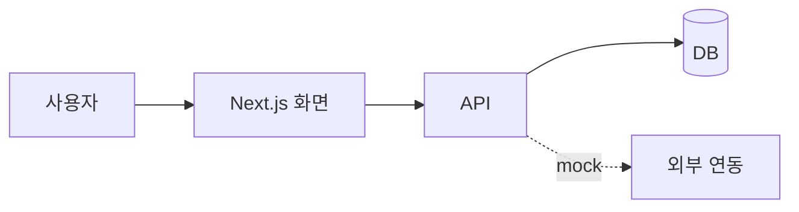

# 예제 갤러리

[리소스 정리](리소스_정리.md)의 항목별 실제 화면 예시입니다. 분류·순위는 리소스 정리와 같습니다.

- 이미지는 각 프로젝트 README에 공식으로 실린 것을 원본 주소로 불러옵니다 (복사본 아님). 원본이 바뀌거나 지워지면 안 보일 수 있습니다.
- 공식 예시 이미지가 없는 항목은 "공식 이미지 없음"으로 표시하고, 어떤 결과가 나오는지 한 줄로 적었습니다. 실제로 써본 뒤 우리 결과 화면으로 채웁니다.

---

## 1. 기술 스택

### 4. Mermaid
GitHub에서 아래처럼 코드 블록만 써도 그림으로 바로 보입니다.

공식 예시 (간트·플로우·시퀀스):

### 6. MSW
브라우저 개발자도구 네트워크 탭에서 mock 응답이 실제 요청처럼 보입니다.

### 1·2·3·5. Next.js, KDS, Zod, Prisma/Drizzle
라이브러리라 별도 결과 화면 없음. KDS 화면 예시는 해커톤 키트의 `templates/`, `examples/`를 로컬 서버로 열어서 확인 (사내 자료라 공개 레포에 캡처를 올리지 않음).

---

## 2. 테스트·검증

### 1. Playwright
공식 이미지 없음. 시험 실행 후 `npx playwright show-report`로 열리는 HTML 리포트(케이스별 PASS/FAIL, 스크린샷, 트레이스)가 e2e-test.md 근거가 됩니다.

### 4. playwright-skill / dev-browser
공식 이미지 없음 (dev-browser는 로고 배너만 있음). Claude가 브라우저를 열어 클릭·입력하며 시험하고 결과를 보고합니다.

### 7. tdd-guard
테스트 없이 구현하려 하면 훅이 막는 장면:

### 2·3·5·6. Vitest, GitHub Actions, @axe-core/playwright, guard-skills
공식 이미지 없음. Vitest는 터미널 PASS/FAIL 목록, Actions는 PR의 체크 결과, axe는 위반 항목 목록, guard-skills는 점검 결과 텍스트가 나옵니다.

---

## 3. 보안

### 2. gitleaks
커밋에 섞인 키·토큰을 찾아낸 결과 화면:

### 7. claude-code-safety-net
위험한 명령이 실행 전에 걸러지는 구조:

### 1·3·4·5·6. security-review, npm audit, security-audit-skill, Semgrep, defending-code-reference-harness
공식 이미지 없음. security-review는 PR에 취약점별 코멘트를 남기고, 나머지는 항목별 결과 목록을 출력합니다. security-compliance.md에 이 결과를 그대로 근거로 붙입니다.

### 외부 스킬 점검 (SkillSpector / skill-scanner)
공식 이미지 없음. 스킬 폴더를 스캔해 위험 지시·스크립트를 목록으로 보고합니다.

---

## 4. 개발 과정·AI 활용 기록

### 2. claude-code-log
Claude Code 대화 기록을 HTML로 바꾼 화면:

### 3. claude-code-action
Issue/PR에서 @claude를 부르면 작업하고 결과를 남기는 장면:

### 4. claude-replay
AI 세션을 재생하는 화면 (발표 시연 겸용):

### 5. ccpm
GitHub Issues 기반으로 작업을 나누고 병렬로 진행하는 화면:

### 1·6. gh CLI, claude-code-transcripts
공식 이미지 없음. gh CLI는 터미널에서 Issue가 생성되고 번호가 출력되며, transcripts는 claude-code-log와 비슷한 HTML 기록을 만듭니다.

---

## 5. 기획·요구사항

### 2. PM Skills Marketplace
PRD 작성 등 명령어로 기획 산출물을 만드는 예시:

### 1·3. Superpowers, claude-code-spec-workflow
공식 이미지 없음. 대화 중에 계획 문서·태스크 목록·테스트 순서를 단계별로 만들어 가며 진행합니다.

---

## 5-1. 문서·아키텍처 자동화

### 1. Repomix
레포를 AI용 파일 하나로 묶은 결과:

### 4. cartographer
코드베이스 구조를 문서로 정리한 결과:

### 2·3. andrej-karpathy-skills, Skill Seekers
공식 예시 이미지 없음. 앞의 것은 CLAUDE.md 규칙 텍스트, 뒤의 것은 문서를 변환한 SKILL.md 폴더가 결과물입니다.

---

## 6. React·UI 품질 스킬

### 5. ui-ux-pro-max
스킬이 제안하는 UX 스타일·규칙 모음 화면:

### 1·2·3·4·6·7. web-accessibility, web-design-guidelines, next-skills, anthropics/skills, frontend-design, shadcn/ui
공식 예시 이미지 없음 (shadcn/ui는 로고만 있음). 화면 결과는 우리 프로젝트에 적용한 뒤 KDS 적용 전후 비교 캡처로 채우는 게 의미가 있습니다. 단 KDS 화면은 사내 자료라 공개 레포가 아닌 팀 저장소에 둡니다.
