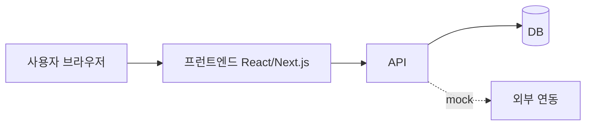

# Architecture

> 최종 갱신: [YYYY-MM-DD] · 기준 SHA: `[커밋]`
> 설계 시점의 의도와 구현 후 실제 구조가 다르면 실제 구조 기준으로 고치고, 변경 이유를 남긴다.

## 1. 전체 구성

## 2. 기술 선택

| 영역 | 선택 | 이유 | 대안 검토 |
|---|---|---|---|
| 프런트엔드 | | React 계열 필수 | |
| UI | KDS | 주최 측 표준 | |
| 백엔드 | | | |
| DB | | | |
| 테스트 | | | |

## 3. 데이터 흐름 (입력 → 처리 → 저장 → 응답)

| 기능 | 입력 | 처리 | 저장 | 응답 | 소스 위치 |
|---|---|---|---|---|---|
| | | | | | `src/...` |

## 4. 데이터 모델

| 엔티티 | 주요 필드 | 관계 | 정의 위치 |
|---|---|---|---|
| | | | `[스키마 파일 경로]` |

## 5. API

| Method | 경로 | 설명 | 권한 | 입력 검증 | 관련 REQ |
|---|---|---|---|---|---|
| | | | | | |

## 6. 권한 경계

| 역할 | 접근 가능 | 접근 불가 | 검증 TC |
|---|---|---|---|
| | | | |

## 7. 실제 vs Mock 구분

| 구성요소 | 상태 | 이유 | 실제 전환 시 필요한 것 |
|---|---|---|---|
| | 실제 / mock | | |

## 8. 의존성 · 배포 · 운영

- **주요 의존성**: [package.json 기준]
- **배포**: [방식, 주소]
- **재시작 / 복구**: [절차]
- **환경변수**: `.env.example` 참고 (실제 값은 문서에 쓰지 않음)

## 9. KDS 외 직접 만든 컴포넌트

| 컴포넌트 | 이유 |
|---|---|
| | |

## 10. 제약과 알려진 한계
- 
