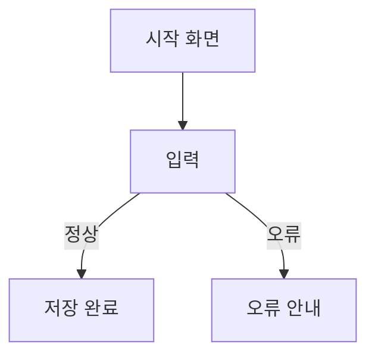

# User Experience

> 최종 갱신: [YYYY-MM-DD] · 기준 SHA: `[커밋]`
> 구현 전에 사용 순서를 정하고, 구현 후 실제 화면·출력·저장 결과로 확인해 갱신한다.

## 1. 사용자 흐름 목록

| FLOW | 사용자 | 목적 | 관련 REQ / AC | 검증 TC | 상태 |
|---|---|---|---|---|---|
| FLOW-01 | | | REQ-01 / AC-01 | TC-01 | 미구현 |

## 2. 흐름 상세

### FLOW-01: [흐름 이름]

| 단계 | 사용자 행동 | 시스템 반응 | 화면 / 근거 |
|---|---|---|---|
| 1 | | | `[스크린샷 경로]` |

**상태별 처리**

| 상태 | 화면에서 보이는 것 | 확인 TC |
|---|---|---|
| 정상 | | |
| 오류 (잘못된 입력) | | |
| 빈 상태 (데이터 없음) | | |
| 권한 없음 | | |
| 복구 (새로고침·재접속) | | |

## 3. API / CLI 사용 (해당 시)

| 호출 | 입력 예 | 정상 응답 | 오류 응답 |
|---|---|---|---|
| | | | |

## 4. 화면 목록

| 화면 | 경로 | 사용 KDS 컴포넌트 | 스크린샷 |
|---|---|---|---|
| | | | |
